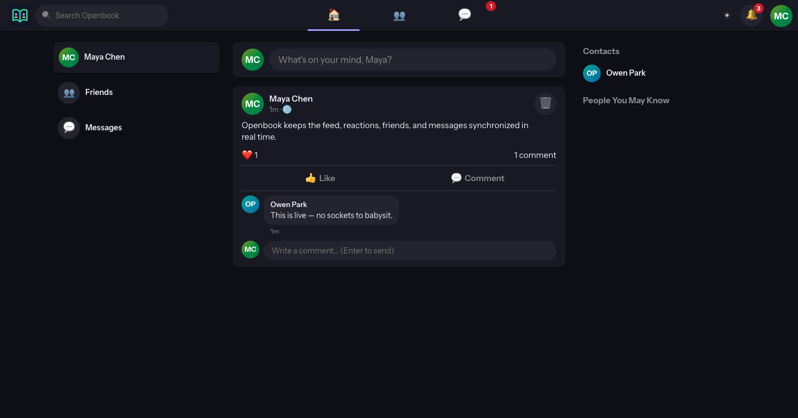

# Openbook

A full-featured **realtime social network** on a single **Convex Realtime** backend —
profiles, friend graph, audience-scoped feed, six-reaction posts, comments,
notifications, and Messenger-style DMs, all live-synced through reactive
queries (no client polling). The repository includes a local-first developer
stack and an operator-gated production path for Cloudflare Pages, Clerk, and
Convex. It does not claim that a public service is deployed.

## Showcase




This capture comes from the fully local self-hosted Convex stack after a real
signup and post. It is the reviewed evidence declared in
`portfolio/manifest.yaml`.

## Features

- **Identity** — Clerk with live keys in production; Convex Auth for fully local
  development. Auto-provisioned profile with deterministic-hue avatar/cover.
  Settings can close the account through a resumable erasure job that removes
  provider identity, sessions, social data, uploads, and billing links.
- **Friend graph** — request → accept lifecycle (decline / cancel / unfriend),
  cross-request auto-accept, *People You May Know* ranked by mutual friends,
  mute (feed only), and block/unblock (hides posts and blocks new requests).
- **Feed** — paginated, newest-first, server-side visibility: `friends`-audience
  posts reach only the author's friends; `public` posts reach everyone; group
  posts reach members. Authors can edit a post and attach a photo or video
  (owned Convex storage; client strips still-image EXIF). Posts support multiple
  images, server-fetched and storage-proxied link previews, and private Save /
  Saved state. Exact per-plan storage quotas apply before ownership is recorded.
  Bounded unused-file and orphan-file sweeps run every 10 minutes.
- **Stories, albums, groups, events** — 24h stories, profile albums,
  groups/pages with member feeds, and events with going/interested RSVP.
- **Reactions** — the classic six (👍❤️😆😮😢😡), one per user per post,
  hover picker, denormalized tallies kept exact in the same transaction.
- **Comments** — paginated threads with exact counts and owner/author delete.
- **Notifications** — in-app bell, paginated notification history, and durable
  Resend delivery. Reports have an operator queue (`OPERATOR_USER_IDS`).
- **Messages** — friends-only threads, presence, typing state, edit/hide,
  last-read receipts, and search.
- **Search** — people, posts, and messages from the nav / messenger.
- **Navigation and forms** — a persistent desktop rail, a mobile bottom bar,
  route focus, a skip link, and named forms with programmatic labels.
- **Clients** — installable PWA; Tauri desktop (`apps/desktop`); Expo mobile
  (`apps/mobile`) with same-origin navigation and recoverable load errors;
  `scripts/open-desktop.sh` for a Chrome app-mode window.
- **SaaS spine** — Stripe-mirrored subscriptions; free cap of 100 posts, 500 MB,
  and 1,000 uploads; Pro has unlimited posts, 10 GB, and 10,000 uploads.

## Usage

| Surface | What you do |
|---|---|
| Local stack | `pnpm install` then `pnpm selfhost` and `pnpm dev` (see Quick start) |
| Cloud | `npx convex dev --once && pnpm auth:setup && pnpm dev` |
| Tests | `make test` or `pnpm test` |
| Live check | `node scripts/verify-live.mjs` against a running Convex URL |
| Browser check | `node scripts/verify-ui.mjs` against the local web and Convex URLs |
| Desktop window | `bash scripts/open-desktop.sh` (Chrome/Edge app mode) |
| Production desktop | `bash scripts/build-desktop.sh` from a configured clean release checkout |
| Mobile shell | `make verify-mobile` in the root; `npx expo start` in `apps/mobile` |
| Backup | `bash scripts/export-backup.sh /absolute/unused-snapshot.zip` |
| Restore drill | `OPENBOOK_RESTORE_DRILL=I_UNDERSTAND bash scripts/restore-drill.sh /absolute/snapshot.zip` |
| Production contract | `pnpm verify:production-contract` |
| Production preflight | `pnpm production:readiness` |
| Hosted probe | `pnpm production:probe` |
| Synthetic load | `pnpm production:load -- --help` |
| Publish gate | `make publish-ready` |

Accounts, posts, and screenshots in this tree are synthetic. Do not commit live Stripe keys or real user data.

```
openbook/
├── convex/                 # the backend: schema + social functions + tests
│   ├── schema.ts           # profiles · posts · comments · reactions · friendships
│   │                       #   · notifications · conversations · messages · billing
│   ├── lib/social.ts       # pairKey · visibility rule · enrichment · notify fan-out
│   └── social.test.ts      # convex-test suite for every social rule
├── packages/shared/        # zod inputs · reaction registry · auth hooks · api re-export
├── apps/web/               # Vite + React 19 + react-router social UI
├── tools/openbookctl/      # readiness · probe · backup · audit · load · CSP rendering
├── production/             # versioned capacity, SLO, and recovery targets
└── docs/production/        # architecture · security · runbook · recovery · launch
```

## Quick start (fully local, no Convex account)

```bash
pnpm install
CONVEX_PORT=3310 CONVEX_SITE_PORT=3311 pnpm selfhost   # Docker OSS Convex + keys + push
(cd apps/web && VITE_CONVEX_URL=http://127.0.0.1:3310 pnpm dev)
```

For cloud development, use `npx convex dev --once && pnpm auth:setup && pnpm
dev`. Production does not use that Convex Auth path. Start with
[`docs/production/README.md`](docs/production/README.md).

## Supported toolchain

The web client uses React 19.2.8, React Router 7.18.2, Convex 1.44,
Clerk React 6.14.4, TypeScript 7, Vite 8.2.1, and pnpm 11.22 on Node 22.13
through Node 25. Node 24.13.1 is the verified release toolchain. Node 26 is not
supported by the current Convex Node-action compiler. Release dependencies are
locked. Newly published patches receive a maturity review before adoption.

The mobile shell uses Expo 57 with its supported React Native 0.86.2 pair.
The desktop shell uses Tauri CLI 2.11.4 and the Tauri 2.11 Rust family.
Dependabot watches every package root and the CI action pins.

## Verification

The dated repository and local-live receipt is
[`docs/evidence/2026-08-21-production-scale-local.md`](docs/evidence/2026-08-21-production-scale-local.md).
Local proof is not hosted launch or scale certification.

| Gate | Command | Result |
|---|---|---|
| Types | `pnpm typecheck` | 2/2 packages clean |
| Unit (simulated backend) | `pnpm test` / `make test` | Social, auth, billing, delivery, migration, upload, telemetry, and HTTP rules |
| Live E2E (real backend) | `CONVEX_SELF_HOSTED_URL=http://127.0.0.1:3310 node scripts/verify-live.mjs` | 43 server checks, including link-preview isolation, upload admission, signed media ranges, friend and message pagination, Saved privacy, and account cascade |
| Browser E2E (real backend) | `URL=http://127.0.0.1:5176 CONVEX_SELF_HOSTED_URL=http://127.0.0.1:3210 node scripts/verify-ui.mjs` | Desktop and 390 px contracts, multi-user writes, forms, focus, Saved, and notifications |
| Production build | `pnpm build` | Vite production bundle |
| Mobile | `make verify-mobile` plus `npx expo export --platform ios|android` | 21/21 Expo Doctor checks; reviewed production audit; both bundles export |
| Desktop | `make verify-desktop` | Tauri Rust graph compiles, the optimized unsigned application builds, and npm audit has no findings |
| Web publication boundary | `pnpm verify:publication` | Go publication-tool tests, types, application tests, build, production dependency licenses, and both secret-scan modes |
| Full repository gate | `make publish-ready` | Web publication boundary, Expo Doctor and audit, desktop npm audit, locked Cargo check, and optimized Tauri build |
| Production contract | `pnpm verify:production-contract` | Go tool tests, capacity schema, bounded-query audit, and edge controls |
| Recovery | `scripts/export-backup.sh` plus `scripts/restore-drill.sh` | Full snapshot verification, disposable import, migration, telemetry, and readiness |
| Capacity | `openbookctl load` | Local smoke or hosted `synthetic_http` certification; realtime sessions need a separate soak |

The live E2E is the same script that verifies a cloud deployment — point
`VITE_CONVEX_URL` at it and re-run.

## Domain rules worth knowing

- **Visibility lives in one function** — `lib/social.ts::postVisibleTo`. Feed,
  profile, `posts.get`, comments, and reactions all use it, so a hidden post
  never reaches a client and cannot be commented on or reacted to.
- **Tallies are denormalized but exact** — content and per-user counters move
  with their source rows. The required user-statistics migration is resumable,
  and readiness fails until it completes.
- **Notifications never self-ping** — `notify()` drops actor==recipient, and
  switching a reaction kind doesn't re-notify.
- **One row per pair** — friendships and conversations are keyed by a sorted
  `pairKey`. Mutations collapse duplicates (accepted / latest thread wins) so
  request/accept and DM-open stay idempotent even without a unique index.
- **Friend lists use one adjacency index** — each accepted friendship writes two
  materialized `friendEdges` rows in the same transaction. The v4 migration
  backfills and deduplicates older accepted pairs before readiness can pass.
- **Reads stay bounded** — production Convex modules use indexes with bounded
  terminal operations. The source audit rejects unbounded collection reads and
  database filters.
- **Provider work is durable** — email, push, Stripe cancellation, and Clerk
  erasure use a deduplicated outbox with leases, retry, dead-job state, and
  readiness checks.
- **Outbound traffic is constrained** — link previews reject private or special
  network targets, pin validated DNS results during each request, limit
  redirects, types, bytes, and time, and proxy accepted preview images through
  owned storage. Push delivery accepts only reviewed browser push hosts.

## Adding to the model

1. Add a table in `convex/schema.ts`.
2. Add `query`/`mutation` functions in `convex/` and rules in `convex/lib/social.ts`.
3. Pin behavior in `convex/social.test.ts` (convex-test, runs in ms).
4. Consume from the web app via `api` from `@openbook/shared`.

## License

MIT. See [`LICENSE`](LICENSE) and
[`THIRD_PARTY_NOTICES.md`](THIRD_PARTY_NOTICES.md).
